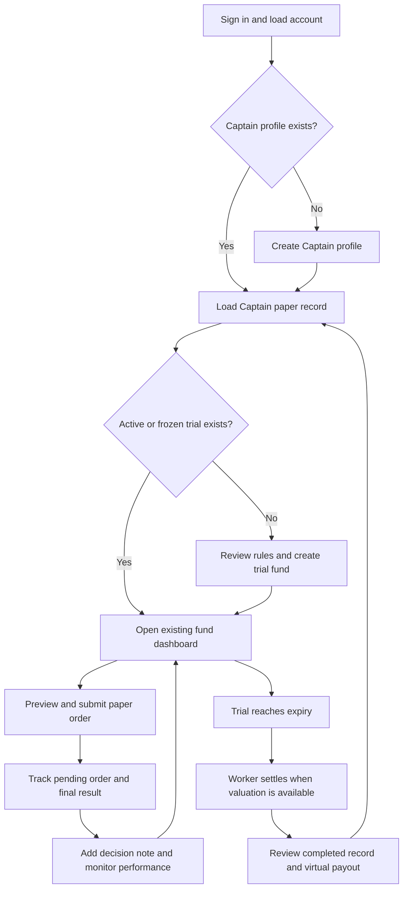

# Captain flow — v0 developer handoff

## Purpose and scope

Explain how a Captain starts and runs a paper trading fund, which backend endpoints
support each step, and what a future client must display.

This document describes the current backend. Screen names and presentation guidance
are proposed UX, not implemented screens. All balances, trades, shares and payouts
are virtual, and financial records are stored offchain in PostgreSQL.

## Journey at a glance



## 1. Sign in and initialize the account

The client obtains an access token through the configured identity provider and
calls `GET /v0/me` with `Authorization: Bearer <token>`.

The backend creates the account on first authenticated use and grants **10,000
virtual USDC once**. Signing in again does not replenish this allowance.

Display:

- User identity and available paper cash.
- A persistent **Paper Trading** label.
- An action to create a Captain profile or resume an existing Captain journey.

Related read: `GET /v0/me/paper-balance`.

Privy access-token verification is required in every environment. The client signs
in with Privy, then calls `POST /v0/auth/privy` or a protected endpoint with its
bearer token. There is no generic provider or development-token bypass.

## 2. Create a Captain profile

Endpoint: `POST /v0/captains`.

```json
{
  "handle": "sol_captain",
  "bio": "My approach to managing a SOL paper trading fund."
}
```

Rules:

- Handle: 3–24 lowercase letters, numbers or underscores; unique.
- Bio: optional, maximum 500 characters.
- A user has one Captain profile.
- Repeating creation with the existing handle returns the existing profile;
  this endpoint does not update the bio.

Read the profile with `GET /v0/captains/:captainId`.
Here `captainId` is the Captain's user ID, not their handle.

## 3. Resume an existing trial or create a new one

Load `GET /v0/captains/:captainId/paper-record` and look for an `ACTIVE` or `FROZEN`
fund. Route the Captain to that fund if one exists.

If none exists, present fund creation with a name, strategy description and a rules
summary. Endpoint: `POST /v0/funds`.

```json
{
  "name": "SOL Momentum Trial",
  "description": "Describe the intended strategy and risk approach."
}
```

Send an `Idempotency-Key` header so retrying this action does not create another fund.

On successful creation:

| Item | Current behavior |
|---|---|
| Captain seed | 1,000 virtual USDC deducted from available personal cash |
| Initial fund NAV | 1,000 virtual USDC |
| Initial share price | 1 virtual USDC |
| Captain shares | 1,000 |
| Duration | 30 days, starting immediately on creation |
| Active trials | One per Captain; frozen trials also occupy this slot |
| Captain stake | Cannot be increased or redeemed through Crew join/exit endpoints |
| Funding | Crew can contribute virtual cash during the active trial |

There is no separate draft, fundraising approval or manual trial-start step.
Fund name is 3–80 characters; description is optional, maximum 1,000 characters.

Creation fails if the Captain profile is missing, another trial is active/frozen,
or available cash is below the seed requirement.

## 4. Open the fund dashboard

Use the fund as the main workspace for the Captain.

| Dashboard area | Endpoint | Display |
|---|---|---|
| Fund identity | `GET /v0/funds/:fundId` | Name, strategy, status and trial dates |
| Policy | `GET /v0/funds/:fundId/policy` | Allowed instrument and risk limits |
| Holdings | `GET /v0/funds/:fundId/holdings` | Fund cash, SOL quantity and cost basis |
| Fund performance | `GET /v0/funds/:fundId/performance` | NAV, unit returns, drawdowns, fees and order counts |
| Captain's investment | `GET /v0/me/funds/:fundId/performance` | Contributions, withdrawals, current value and personal P&L |
| Performance chart | `GET /v0/funds/:fundId/history?after=0&limit=100` | NAV and share-price snapshots |
| Recent orders | `GET /v0/funds/:fundId/orders` | Submitted orders and their statuses |
| Activity | `GET /v0/funds/:fundId/events?after=0` | Trades, joins, exits, fees and settlement events |

Fund performance and the Captain's personal result are separate measures. Crew
contributions increase fund NAV without representing trading profit. Use share-price
returns for fund performance, rather than percentage change in total fund NAV.

Show valuation freshness. Do not convert unavailable values to zero or imply that a
stale exposed position has a reliable current value. Short trials may not yet have
eligible 7-day or 30-day return values.

## 5. Preview a paper order

Trading flow: **Buy/Sell → Amount → Preview → Confirm**.

Endpoint: `POST /v0/funds/:fundId/orders/preview`.

```json
{
  "side": "BUY",
  "instrumentId": "SOL",
  "notionalUsdc": "50.000000"
}
```

`notionalUsdc` is a decimal string for both buys and sells. It is not a SOL quantity.

Current policy:

- SOL spot only; no leverage, shorting or derivatives.
- Order notional between 1 and 1,000 virtual USDC.
- Per-order cap of 10% of fund NAV, in addition to the 1,000-USDC cap.
- Maximum SOL position exposure of 25%.
- A 30% drawdown breaker freezes buys and allows permitted risk-reducing sells.
- Buys require sufficient fund cash; sells require sufficient position quantity.

Display the estimate, costs and policy outcome returned by the preview. Invalid
orders should show the backend reason. A preview neither reserves assets nor
guarantees a later fill: price, balances and policy can change before execution.

Only the fund's Captain may preview or submit its orders.

## 6. Submit and follow the order

Endpoint: `POST /v0/funds/:fundId/orders`, using the same body as preview and an
`Idempotency-Key` header. A successful submission returns HTTP `202`.

Client behavior:

1. Preserve the key for retries of the same submission.
2. Display the submitted order as pending.
3. Follow `GET /v0/funds/:fundId/orders/:orderId` or fund events.
4. Display the actual terminal result, fill quantity, fill price and fees.
5. Refresh holdings, balances and performance after relevant events.

The worker waits at least three seconds, requires a fresh eligible observation
after submission, and rechecks execution policy. Orders can time out after 120
seconds without eligible execution. Submission success does not mean execution
success.

Cancellation: `POST /v0/funds/:fundId/orders/:orderId/cancel`.
Only the Captain can cancel an order, and only before it has been processed.
If cancellation races with execution, use the backend's returned result.

Display statuses separately: pending, filled, partially filled, rejected and
cancelled. Schema support for a partially filled status should not be treated as
a promise that every execution path produces partial fills. Count filled and
partially filled orders as completed trades; do not count rejected/cancelled orders.

## 7. Publish decisions and communicate with Crew

| Action | Endpoint |
|---|---|
| Add an order decision note | `POST /v0/funds/:fundId/orders/:orderId/notes` |
| Read decision history | `GET /v0/funds/:fundId/decisions?after=0` |
| Post fund chat | `POST /v0/funds/:fundId/messages` |
| Read fund chat | `GET /v0/funds/:fundId/messages?after=0` |

Notes use `{ "body": "Reason for the decision" }`. Corrections additionally use
`correctsMessageId` to reference the original note. Corrections append to history;
they do not overwrite the original record. Chat uses `{ "body": "Message" }`.
These writes require an `Idempotency-Key` header.

Decision notes are currently optional and posted after an order exists. There is
no mandatory pre-trade rationale gate. The Captain and current Crew members can
post chat; only the Captain can post order decision notes.

## 8. Monitor the trial and fees

Refresh fund performance throughout the trial. Display:

- Since-inception net and gross returns, and available 7/30-day returns.
- Current and maximum drawdown.
- Filled trade counts, with pending/rejected/cancelled orders separate.
- Trading costs and recorded performance fees.
- Time remaining and valuation status.

The simulated performance fee is 10% of eligible gains above the post-fee high-water
mark. It is implemented by minting shares, split 80% to the Captain and 20% to the
protocol. The worker permits at most one eligible positive assessment per UTC day.
The high-water mark prevents repeated charging on recovery below that threshold.

Gross returns reverse recorded performance-fee dilution but still include trading
costs. They are not hypothetical returns before all costs.

For live activity, use `GET /v0/funds/:fundId/events/stream`. Resume with `after`
or `Last-Event-ID`, and deduplicate events by sequence. On reconnect, catch up and
refresh authoritative state instead of assuming an uninterrupted connection.

Inbox reads: `GET /v0/me/notifications?after=0`.
Mark read: `POST /v0/me/notifications/:notificationId/read`.
Notifications are durable in-app records; external push delivery is not configured.

## 9. Trial expiry and settlement

There is no Captain-facing manual completion endpoint. The worker detects expiry.

Settlement flow:

1. Obtain an eligible valuation; defer if market-exposed positions lack fresh prices.
2. Liquidate remaining paper assets with the recorded simulation haircut.
3. Assess any eligible final performance fee.
4. Redeem holder shares and credit virtual payouts to their personal balances.
5. Burn shares, mark the trial/fund completed and retain final performance values.
6. Deliver completion notifications through the outbox worker.

The client should distinguish **trial time elapsed** from **settlement completed**.
An expired fund awaiting a usable valuation must not show a completed payout.

## 10. Review the completed record

Use `GET /v0/captains/:captainId/paper-record` for public Captain fund records and
`GET /v0/me/paper-record` for the signed-in user's investment results, including
completed and exited allocations.

Show final returns, drawdown, fees, completed trade count, order history, decisions
and the Captain's settled personal result. Independent fund trials are separate
records; do not add their return percentages together.

The Captain may start another trial if there is no active/frozen trial and enough
virtual cash remains. Completion does not automatically grant qualification,
approve a live fund or move funds onchain.

## Client integration conventions

- Authenticate private reads and mutations with the bearer token.
- Send financial inputs as decimal strings. Avoid binary floating-point money math.
- For idempotent writes, generate one key per intended action and reuse it for
  transport retries. Reusing a key with a different payload causes a conflict.
- Display structured backend errors and recover by refreshing state where needed.
- Public fund data is readable without Captain ownership; writes enforce ownership.
- Use returned identifiers rather than handles or client-generated substitute IDs.
- Chart history is cursor-paginated. Follow its `nextCursor` until exhausted.
- Fund events, decisions and messages use an `after` sequence cursor.

## Complete history reads

Full trade pagination, Captain-wide statistics and the private Crew timeline are implemented. See [the history API](./paper-history-api.md) for `/v0/captains/:captainId/orders`, `/v0/captains/:captainId/trade-statistics`, `/v0/me/crew-transactions` and cursor semantics.

## Current gaps and future work

| Gap | Current behavior |
|---|---|
| Explicit Crew member roster | Activity events and financial projections exist; no dedicated roster endpoint |
| Profile/fund editing | Creation and read endpoints exist; no dedicated edit flow |
| Manual early trial completion | Not exposed |
| Automatic qualification and live launch | Future product work |
| Mobile/web screens | Not built; backend-only delivery |

## Source map

- `apps/api/src/auth.ts`: identity and one-time paper allowance.
- `apps/api/src/account-routes.ts`: account and Captain profile endpoints.
- `apps/api/src/funds.ts` and `fund-routes.ts`: trial creation, reads and policy.
- `apps/api/src/orders.ts` and `order-routes.ts`: preview, submission and cancellation.
- `apps/api/src/performance.ts`: returns, history and public/private records.
- `apps/api/src/social.ts`, `events.ts`, `notifications.ts`: decisions, chat and updates.
- `apps/worker/src/orders.ts`, `fees.ts`, `trials.ts`: execution, fees and settlement.
- `docs/backend-simulation-report.md`: existing verification coverage and limits.
- `docs/v0-paper-trading-architecture.md`: broader design, including future scope.

Prepared against the backend on October 1, 2026. Recheck the source when contracts change.

## Profile and banner edits

After creating a Captain profile, update its bio and hosted image URLs with `PATCH /v0/captains/:captainId`. The public GET and create responses include `avatarUrl` and `bannerUrl` (null until configured). See [profile endpoint and storage setup](captain-profile-assets.md). For new files, reserve a signed upload through `/v0/captains/:captainId/assets/uploads`, PUT the file to storage, then call `/v0/captains/:captainId/assets/uploads/:uploadId/complete`. Completion validates and attaches the image automatically; PATCH can reselect only completed owned assets.
