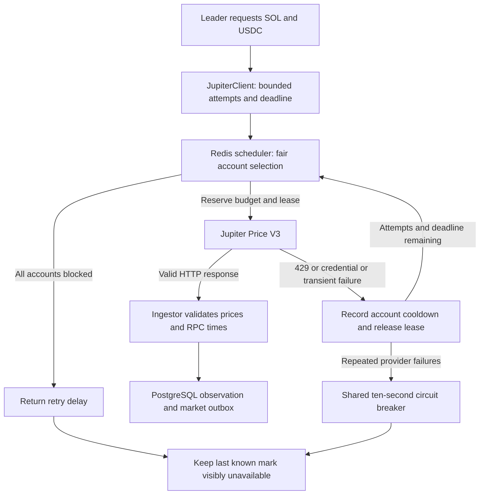

# Jupiter account client

Implemented 6 October 2026 for the SOL/USDC ingestor. The client owns credential selection, quota reservations, HTTP fallback and failure cooldowns. The ingestor still owns PostgreSQL leadership, source-time validation, observations and durable market events.

## Configuration

Fill at least one of `JUP_ACC_1` through `JUP_ACC_10` in the backend service environment. Each populated slot represents a different Jupiter organisation, as configured for this deployment. Empty slots are allowed; numeric ordering is stable. Duplicate secrets and mixed numbered/legacy configuration fail startup without logging credentials. `.env.example` contains the full list; scripts require environment variables to be exported by the shell or deployment manager.

The organisation identity used in Redis is the slot name, not the secret. Every process sharing these budgets must assign the same actual organisation to the same slot. Rotate a secret in its existing slot. Reassigning an organisation to another slot would reset its local budget. For multiple keys from one organisation, use the legacy comma-separated `JUPITER_API_KEYS` with a common `JUPITER_ORGANISATION_ID` instead; the numbered setup intentionally assumes independent organisations.

All replicas must share Redis, and Redis should use persistence and `noeviction`. The client fails closed if Redis commands fail. After complete Redis data loss, quota history is gone: wait at least one full 60-second provider window before restarting ingestion to avoid using a freshly empty local budget against an already consumed upstream quota. External Jupiter consumers are not included unless they also reserve through this scheduler.

## Request flow



| Condition | Behavior |
| --- | --- |
| Healthy account | Atomically reserve one request in its organisation's sliding window and a ten-second lease; fetch SOL/USDC in one call; release lease on completion |
| Organisation quota | Maximum 48 attempts per rolling minute; at least 1,250 ms between request reservations; retries consume quota |
| 429 with reset | Organisation cooldown until the absolute reset in Unix seconds, converted to milliseconds, plus 250 ms; minimum one-second cooldown |
| 429 without reset | Organisation cooldown of five seconds plus up to 499 ms jitter |
| 401/403 | Disable that credential for one hour; a replacement secret can recover while the organisation budget remains |
| Network timeout/error, 408 or 5xx | Organisation cooldown of two seconds plus jitter, then fallback; failures in three distinct organisations within 20 seconds open a ten-second provider breaker |
| Fewer than three organisations | Provider breaker threshold equals configured organisation count |
| Invalid JSON or other non-retryable HTTP error | Stop this logical fetch without rotating accounts or disabling credentials |
| Missing token/invalid row | Return decoded data to existing ingestion validation; no credential rotation |
| All accounts blocked | Return earliest cooldown/pacing/window/lease delay instead of sleeping or spinning inside the client |
| Redis failure | Stop, including fallback and reservations; never fetch without a confirmed permit |
| Caller cancellation | Abort current HTTP request, release lease, stop fallback |
| Logical limits | At most three distinct accounts, eight-second request budget including queue time, four-second HTTP timeout, two active logical calls, at most 32 queued calls |

Redis uses server time for quotas and absolute cooldowns. Budget acquisition is atomic across replicas, and leases are released only by their owning token. Leases expire after crashes. The transient-failure set stores distinct organisation IDs; repeated errors from one organisation cannot trip the three-organisation breaker. Successful HTTP responses clear that failure streak. Cooldown expiry permits normal selection again; this implementation has no dedicated half-open probe or provider status endpoint.

Failed individual attempts never write market status. Only final logical-fetch failure reaches the ingestor's failure path. That path retains the previous mark with `UNAVAILABLE` status and unchanged source, quote, receipt and observation fields. Without a prior mark it publishes null values. Repeated identical failures deduplicate. RPC/storage errors are handled separately and cannot disable Jupiter credentials. Consumers must honor status even when numeric values remain present.

The poll target remains five seconds, and the supported feed remains SOL normalized by USDC's actual USD price. Ten organisations allow a configured ceiling of 480 attempts/minute, but this change does not consume that capacity automatically. Expanding token coverage or reducing polling intervals is a separate workload decision.

## Modules

| File | Responsibility |
| --- | --- |
| `apps/ingestor/src/config.ts` | Load numbered accounts or legacy configuration; reject duplicates/ambiguity |
| `apps/ingestor/src/scheduler.ts` | Distributed quota, pacing, leases, credential disable, account cooldown and provider breaker |
| `apps/ingestor/src/client.ts` | HTTP failure classification, bounded fallback, queue/concurrency and abort propagation |
| `packages/market-data/src/jupiter.ts` | Price V3 transport/decoding; absolute reset header; per-request timeout |
| `apps/ingestor/src/ingest.ts` | Price/source validation and durable observation/status writes |
| `apps/ingestor/src/index.ts` | Configure client; retain leader election; honor retry delays and shutdown |

Diagnostic callbacks expose slot ID, attempt, failure type, HTTP status and cooldown duration. They contain no API keys, provider bodies or RPC URLs. Current runtime logs failures; persistent metrics and alerting can be connected to the callback separately.

## Verification

Requires the backend dependencies and `redis-server` on `PATH`. Tests start an isolated Redis process using a temporary Unix socket, with TCP disabled and no disk persistence. They use dummy credentials and mocked provider/RPC transport; no live Jupiter calls are made.

```sh
pnpm build
pnpm check-types
pnpm --filter @socially/ingestor test
```

Coverage includes fair ten-account rotation, quota isolation and sliding-window expiry, concurrent reservations from two scheduler instances, lease ownership, absolute/missing reset behavior, one-hour credential disable and secret replacement, shared legacy budgets, bounded retries, network/HTTP fallback, circuit-breaker opening/recovery, malformed/missing data, Redis fail-closed behavior, cancellation/deadlines/concurrency, and preservation/deduplication of last known timestamps. Database status-write tests use a transaction fixture; they do not replace a live PostgreSQL/outbox integration test.

Remaining deployment checks: real credentials and actual reset headers, production RPC block-time availability, PostgreSQL leadership/failover, Redis restart/recovery, and end-to-end snapshot/replay behavior with preserved unavailable marks. No database schema migration or frontend change is needed for this client.
