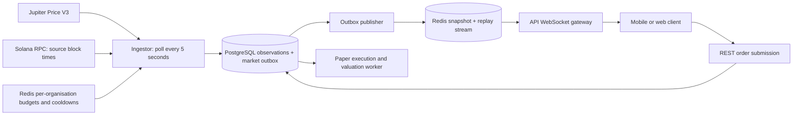

# Jupiter ingestion and WebSocket integration — v0

Implemented 4 October 2026; account-aware Jupiter client added 6 October 2026. Backend only. Client failure handling and distributed quotas have local automated coverage; live Jupiter credentials and end-to-end WebSocket reconnects still need deployment validation.

## Flow



One ingestor leader fetches SOL and USDC in one batch. A PostgreSQL session advisory lock selects the leader across replicas. Other replicas can publish pending outbox events. Each gateway reads the same stream with its own cursor and broadcasts events to its local clients. Client count never creates extra Jupiter requests.

The five-second interval is a polling target. Successful observations publish immediately after the database commit; there is no extra five-second buffer. Network time, upstream price updates, rate limits and outages can increase the interval. WebSockets remove frontend polling, but cannot promise zero latency or guarantee a new price every five seconds.

### Provider and rate budget

- [Jupiter Price V3](https://developers.jup.ag/docs/price): server-side `x-api-key`, maximum 50 mint addresses per request. v0 requests only wrapped SOL and USDC and exposes SOL trading.
- [Jupiter free limits](https://developers.jup.ag/docs/portal/rate-limits): 1 request/second, 60/minute, organisation scope across keys/teams. Multiple keys belonging to one organisation still share one quota.
- `JUP_ACC_1` through `JUP_ACC_10` each contain one server-only key from a **different** organisation. At least one is required; empty slots are ignored. All replicas sharing Redis must use the same organisation-to-slot mapping. Keep a slot assigned to its organisation when rotating its secret so its consumed quota and cooldown remain intact. Never put two keys from the same organisation into different numbered slots.
- Legacy `JUPITER_API_KEYS` plus `JUPITER_ORGANISATION_ID` remains supported as an alternative for one organisation; those keys share one quota. Mixing legacy and numbered configuration, or repeating a credential, fails startup with a secret-free error.
- Healthy accounts rotate round robin. Each organisation has a Redis-backed 60-second sliding window capped at 48 calls and spaced by at least 1,250 ms, including retries. A short Redis lease prevents overlapping requests for the same organisation across replicas. Ten independent organisations therefore have a configured combined ceiling of 480 requests/minute; this is capacity, not a promised provider throughput.
- Normal SOL/USDC polling stays at a five-second target (about 12 calls/minute). More keys provide fallback and room for future batches; they do not automatically increase polling or add tokens. Other Jupiter integrations must use the shared scheduler or be budgeted separately; calls made outside it are not counted locally.
- HTTP 429 cools only its organisation until the absolute `x-ratelimit-reset` time plus 250 ms, with a minimum one-second wait. Missing reset uses five seconds plus jitter. HTTP 401/403 disables only that credential for an hour. Network errors, per-request timeouts and HTTP 408/5xx apply a short organisation cooldown and try another eligible account.
- Each logical fetch tries at most three distinct accounts, with a four-second per-request timeout and an eight-second request budget including queue time. The client allows two active logical fetches and a bounded queue. Caller cancellation stops fallback; Redis lease cleanup may finish after the request budget expires.
- Transient failures across three distinct organisations within 20 seconds pause the shared Price V3 client for ten seconds (with fewer configured organisations, the threshold is their count). Rate limits and invalid credentials do not open this provider breaker. Cooldowns expire automatically; a successful request clears the transient-failure streak.
- Malformed JSON, missing token rows and invalid price fields do not trigger credential rotation. The ingestion layer still validates SOL/USDC prices and source times. A successful fallback produces one accepted ingestion result without first publishing an unavailable event.
- When every account is blocked the scheduler returns the earliest eligible retry delay. The leader observes that delay and the normal polling interval, avoiding a busy loop. Diagnostics contain account slot, failure category and HTTP status; never keys or raw provider responses.
- Redis failure blocks new upstream requests. Requests never bypass the shared budget during an outage.

Implementation details, test commands and operational assumptions: [Jupiter account client](jupiter-account-client.md).

### Price and paper execution semantics

Jupiter returns USD prices. `priceUsdc = SOL priceUsd / USDC priceUsd`; USDC is not assumed to equal one dollar. Normalized amounts are decimal strings. Provider JSON numeric precision limits still apply.

The ingestor resolves both `blockId` values with Solana RPC [getBlockTime](https://solana.com/docs/rpc/http/getblocktime). `sourceAt` is the older of the SOL and USDC block times. PostgreSQL records the SOL block ID, USD prices, USDC block ID/time and actual fetch receipt time. Missing tokens, invalid decimals, unknown block times, future source times beyond five seconds and source age over 90 seconds do not create executable observations. Older observations cannot replace a newer accepted mark. Repeated observations do not reset their original receipt time.

Display marks are `CURRENT` only while both source and receipt ages are at most 15 seconds; otherwise `STALE`. Exhausted provider fallback or ingestion validation failures produce `UNAVAILABLE`, retaining the last known price and its original provenance/timestamps when one exists. This does not create a new executable observation or make an old price fresh. The gateway also derives stale status when no new event arrives. Clients must check status and apply the same age check locally if their connection stops.

Paper consumers accept `JUPITER_PRICE_V3`, plus explicitly enabled local-only `DEV_SEED`. Pyth ingestion is removed from the worker's runtime and CLI. Existing historical Pyth records remain in the database. The paper worker runs independently every two seconds, retains the three-second minimum order delay, and requires observation source **and** receipt times at or after `submittedAt + 3 seconds`. Orders wait for a qualifying observation or reach the existing 120-second timeout. A displayed price is not a guaranteed fill. Execution/valuation freshness remains 90 seconds, while UI display freshness is 15 seconds; a recent stored observation can still be used during a short provider outage.

Spread, impact, simulated fee and rounding remain fill model version 1. No onchain vault, wallet transaction or live Jupiter swap is invoked.

## Modules and persistence

| Module | Responsibility |
| --- | --- |
| `apps/ingestor` | Leader scheduling, credential rotation, rate budget, ingestion and outbox delivery |
| `packages/market-data/src/jupiter.ts` | Provider response validation and source-time RPC adapter |
| `packages/market-stream` | Shared DTOs, Redis publisher, consistent snapshots, replay and cache recovery |
| `packages/db/migrations/011_market_ingestion.sql` | Provenance columns, feed instance/sequence, market events and latest records |
| `apps/api/src/market-routes.ts` | REST snapshot, WebSocket subscriptions, authentication, heartbeat and fanout |
| `apps/worker` | Order processing, valuation, fees, settlement and existing notification outbox |

Observations and market events commit together. A locked feed-state row orders event sequences by commit. Publishing to Redis is idempotent: if a process dies after publishing but before the delivery acknowledgement commits, retrying does not duplicate the stream event. Redis holds the latest snapshot and up to 10,000 replay events. PostgreSQL retains durable observations/events; define retention and archival before sustained production use.

After Redis loss the cache restores from a consistent PostgreSQL snapshot and creates a replay boundary. Older cursors must resync. Configure Redis with persistence and `noeviction`; partial eviction can invalidate snapshot/replay consistency. Do not manually edit stream keys. Feed keys include the database feed UUID; after restoring/replacing a database, clear client cursors and fetch new snapshots.

The latest price endpoint falls back to PostgreSQL if Redis is unavailable. It returns `cursor: null` in that case; this fallback cannot promise WebSocket continuity. `/health` remains process liveness, not provider readiness.

## Setup

1. Install dependencies and run database migrations through 011.
2. Start PostgreSQL and Redis; configure Redis persistence and `noeviction` for deployment.
3. Configure these server environment variables (see `.env.example`):

| Variable | Service | Value |
| --- | --- | --- |
| `DATABASE_URL` | All | Shared PostgreSQL database |
| `REDIS_URL` | API, ingestor | Shared Redis instance |
| `JUP_ACC_1` … `JUP_ACC_10` | Ingestor | At least one populated server-only key; one different organisation per numbered slot, identical mapping on every replica |
| `JUPITER_API_KEYS`, `JUPITER_ORGANISATION_ID` | Ingestor | Legacy alternative for keys belonging to one organisation; omit when using numbered slots |
| `SOLANA_RPC_URL` | Ingestor | Mainnet RPC supporting `getBlockTime`; budget RPC calls separately |
| `PRIVY_APP_ID` | API | App ID for private notification authentication |
| `WS_ALLOWED_ORIGINS` | API | Exact comma-separated browser origins, e.g. `https://app.example.com` |

Environment files are not automatically loaded by these scripts; export values into each service process using your deployment manager or shell. Keep Jupiter keys, RPC credentials and Redis credentials off the frontend. In production use HTTPS/WSS with reverse-proxy upgrade support. Browser origins are rejected in production unless explicitly allowed; native clients without an Origin header are supported. Origin filtering is not authentication.

```sh
pnpm install
pnpm --filter @socially/db migrate
pnpm build
# Run as separate processes with their environment configured:
pnpm --filter @socially/ingestor start
pnpm --filter @socially/worker start
pnpm --filter @socially/api start
```

Ingestor restarts are safe: leadership is reacquired and pending market events are delivered. The API supports SIGINT/SIGTERM shutdown. Size PostgreSQL pools and gateway replicas for expected connections.

## REST snapshot

`GET /v0/market/prices?instruments=SOL` — public, no-store. Omit `instruments` for the same supported set. Other instruments return 400.

```json
{
  "mode": "PAPER",
  "transport": "redis",
  "cursor": "42-0",
  "firstCursor": "1-0",
  "prices": [{
    "instrumentId": "SOL", "mint": "So11111111111111111111111111111111111111112",
    "priceUsd": "150.000000000000000000", "priceUsdc": "150.015001500150015002",
    "source": "JUPITER_PRICE_V3", "sourceBlockId": "123456789",
    "sourceAt": "2026-10-04T10:00:00.000Z", "quoteSourceBlockId": "123456789",
    "quoteSourceAt": "2026-10-04T10:00:00.000Z", "receivedAt": "2026-10-04T10:00:01.000Z",
    "observationId": "00000000-0000-4000-8000-000000000001", "status": "CURRENT", "reason": null
  }]
}
```

An uninitialized feed returns `prices: []`. Unavailable entries carry a reason and preserve the last known prices/provenance if available; otherwise these fields are null. An unavailable price must not be treated as a current quote. Database fallback returns `transport: "database"`, `cursor: null` and no `firstCursor`.

## WebSocket protocol

Connect to `wss://<api-origin>/v0/ws` (local: `ws://127.0.0.1:3000/v0/ws`). JSON text frames only. The server sends:

```json
{"type":"hello","mode":"PAPER","channels":["market.prices","account.notifications"]}
```

### Public prices

```json
{"type":"subscribe","channel":"market.prices","instruments":["SOL"]}
```

Server sends `{type:"snapshot",channel:"market.prices",cursor,prices}` from a consistent Redis snapshot. Subsequent observations send `{type:"price_update",channel:"market.prices",cursor,eventId,price}`. Outage events use `market_status` with `price`; derived freshness changes use `market_status` with `prices`. Handle both shapes.

Reconnect with the last applied event cursor:

```json
{"type":"subscribe","channel":"market.prices","instruments":["SOL"],"after":"42-0"}
```

A retained cursor receives `subscribed` followed by events after that cursor. An expired, future or reset cursor receives `resync_required`, then a new snapshot. Invalid cursor syntax receives `error`. Keep cursors as strings, never floats. Apply the snapshot atomically; deduplicate events by cursor/event ID. Derived status messages can share the last event cursor: apply their freshness status even when that cursor has already been seen.

A valid reconnect cursor does not send another snapshot: retain prior client state or omit `after` for a fresh snapshot. `stream_unavailable` means keep prices visibly unavailable/stale and retry with backoff. Use the REST fallback if necessary. Reconnect with exponential backoff and jitter; do not immediately retry in a tight loop.

### Private inbox

First bootstrap the user over `POST /v0/auth/privy`. Then send the current Privy **access token** in a WebSocket frame; never place it in the URL:

```json
{"type":"authenticate","accessToken":"<Privy access token>"}
```

Server verifies Privy and responds `{type:"authenticated",expiresAt}`. Then subscribe:

```json
{"type":"subscribe","channel":"account.notifications","after":"0"}
```

The server queries only the verified user's durable notifications, sending `{type:"notification",channel:"account.notifications",cursor,notification}`. `notification` matches the REST inbox DTO. Cursor is a decimal notification ID, separate from the market cursor. Restart from the last applied notification ID; default zero replays history. Gaps are normal because IDs are global across accounts. A future notification cursor waits until IDs advance beyond it; initialize cursor from that account's actual inbox.

At expiry the server sends `authentication_required` and removes private subscriptions. Obtain a fresh access token, authenticate again, and resubscribe with the account's last cursor. Every authentication attempt clears the prior identity/subscription. Clear private state on logout or account switch and close the socket. Invalid requests receive `{type:"error",code:"request_rejected",message}`; fetch bootstrap/auth status over REST to diagnose.

Unsubscribe either channel with `{type:"unsubscribe",channel}`. There is one subscription per channel per connection.

### Limits and existing flows

- Maximum frame 8 KiB; at most 20 inbound frames per ten seconds and five pending requests per client.
- Buffered outbound data over 256 KiB triggers close 1013; reconnect and resync.
- Gateway sends protocol ping every 20 seconds and terminates clients missing the next pong. Browser/native WebSocket libraries normally handle protocol pong automatically.
- Up to 1,000 connections per gateway instance; deploy replicas behind a WebSocket-capable load balancer. No sticky sessions are needed for cursor replay.
- Market/inbox polling is every 500 ms, with one shared market read per gateway and one query per subscribed account. This is a v0 scale choice; private delivery and notification worker latency remain measurable.
- Fund activity/chat continue through the existing fund SSE stream and REST endpoints. WS currently exposes only the two listed channels. Refetch holdings/order/performance views after relevant notifications/fund events.
- Financial commands use REST with existing ownership checks and idempotency. WS messages cannot create trades, contributions or exits.

## Rollout checks still required

Before production, exercise migrations on a fresh and existing database, real configured Jupiter/RPC responses, PostgreSQL multi-replica leadership, Redis restart recovery, slow clients, token expiry and reconnect cursor boundaries. Shared quota/backoff and provider-breaker recovery are covered with isolated local Redis; live provider behavior and gateway/account load remain unverified. Add metrics/alerts for observation age, ingestion failures, quota waits and outbox backlog.
