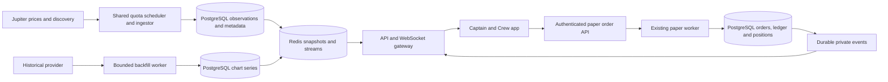

# Dynamic paper trading, shared market data and fast charts — implementation handoff

Prepared: 10 October 2026 (Asia/Kolkata).

Status: implementation plan requested by the product owner; this document does not claim the work below is implemented. The prior discovery rollout and token-icon fix are already in the working tree. Reconcile current source before editing.

## 1. Product outcome

A Captain can discover a Jupiter token, open its chart, select a vault, preview a paper buy, submit it, see a confirmed position and updated balance, then sell it. This must work for eligible newly discovered assets without adding each token to a source-code list. Crew balances and vault performance reflect the same committed accounting and market observations.

The experience should open cached screens immediately, refresh quietly, recover pending trades after interruption, and push committed changes. Upstream requests should depend mainly on distinct active assets and feeds, rather than user count.

“All tokens” means the product has no arbitrary four-token allowlist. It does not promise an executable price for every mint at all times: missing prices, unsupported precision, inactive assets and stale observations must produce explicit temporary or structural reasons. Do not fabricate prices, history or fills to hide missing data.

## 2. Scope and boundaries

Required:

- Dynamic instrument registration, global eligibility and versioned vault policy support.
- Shared, demand-driven price ingestion with organisation-aware quotas and recovery after restart.
- Integration with existing paper preview, submission, fill, ledger, valuation and settlement paths.
- Dynamic token charts using recorded observations and a historical-provider adapter.
- Redis read caches and durable PostgreSQL records with bounded jobs and request coalescing.
- Private order/vault updates, reduced client polling, reconnect recovery and measured load tests.
- Actual local rollout, live-provider verification and honest reporting of unverified device/provider gates.

Preserve the current harbor/frosted UI, new Top traded default, remote token icons, automatic paper-account initialization, Captain/Crew authorization and wallet functionality. Paper trades do not move onchain tokens. No contract deployment is required.

Do not change the $100 Captain seed, contribution rules, fundraising deadlines, existing fees, position/order limits, drawdown economics or fill-model constants as a side effect. Liquidity-dependent slippage, limit orders, stop losses, leverage, shorting and funding resets are separate product work. Keep the existing simulated fee/slippage model versioned and visible.

## 3. Current state and starting points

Two independent repositories: `backend/` and `apk/`. There are substantial uncommitted discovery changes in both. Read both `AGENTS.md` files, record git status, preserve those changes and do not reset files to HEAD. Graphify was unavailable during this handoff; try its required query/update commands when available. Read matching Expo SDK documentation before touching native APIs.

| Area | Existing implementation / change needed |
| --- | --- |
| Registry | `packages/market-data/src/catalog.ts` hardcodes SOL/JUP/JTO/BONK, plus USDC reserve. |
| Storage | `instruments` already stores text ID, symbol, mint, decimals and active flag; migration 020 adds a unique mint index. Extend this table. |
| Discovery | `apps/api/src/market-discovery.ts` and `market-catalog.ts` derive support from the static registry; new tokens receive `unsupported_instrument`. |
| Contracts | `packages/contracts/src/markets.ts`; generated APK copy via `scripts/sync-market-contracts.mjs`. |
| Prices | `apps/ingestor/src/index.ts`, `ingest.ts`, `metadata.ts`; static price batch every five seconds, metadata roughly every minute. |
| Quotas | `packages/market-data/src/scheduler.ts`; shared Redis organisation window, 48 attempts/minute, 1.25-second pacing, token ceiling at shared count 28. |
| Caching | `packages/market-data/src/discovery.ts`; 60-second fresh snapshots, bounded stale fallback, distributed locks, durable snapshots. |
| Policies | `apps/api/src/vaults.ts` and `funds.ts` copy the static tradable IDs into each policy version. |
| Orders | `apps/api/src/orders.ts`, `vault-routes.ts`, `order-routes.ts`; already query DB instruments but enforce saved policy and ID length <=32. |
| Worker | `apps/worker/src/orders.ts`, `valuation.ts`, `vault-rounds.ts`; broadly instrument-generic, but depend on fresh observations for every position. |
| Context | `apps/api/src/trading-context.ts`; holdings metadata and limits use `supportedById`. |
| History | `packages/market-data/src/history.ts`, API `market-catalog.ts`; static-registry gate; stored samples and partial coverage already exist. |
| Streaming | `apps/api/src/market-routes.ts`, `packages/market-stream/src/index.ts`; public prices, authenticated notifications, durable event delivery and cursor recovery already exist. |
| Client | `apk/src/hooks/use-markets.ts` polls list every 30 seconds and up to three private resources every five seconds. |
| Orders UI | `apk/src/hooks/use-paper-order.ts` persists uncertain intents and polls status every two seconds; preserve its idempotent recovery. |
| Charts UI | `apk/src/hooks/use-market-history.ts` polls tracked charts every 30 seconds; row/detail reads already coalesce in `src/api/markets.ts`. |

Local rollout baseline: migration 028 applied; local backend and APK discovery flags enabled; live Top traded and Trending each returned 100 candidates. One warm 100-reader test added zero token-scheduler acquisitions. This is not a production capacity guarantee. See `market-discovery-local-rollout.md` and `paper-trading-discovery-implementation.md`.

## 4. Architecture



PostgreSQL is authoritative for money, fills, policies, durable observations and job recovery. Redis holds replaceable caches, leases, shared quotas and streaming state. Losing Redis must neither lose money nor allow unbudgeted upstream requests. Each upstream request must acquire a shared permit, including retries and requests made by API cold paths.

## 5. Proposed schema changes

Use additive, numbered migrations after the latest actual migration; do not assume 029 is still free. Reuse existing tables and indexes where possible. Explain schema choices in the implementation report.

### 5.1 Instrument identity and eligibility

- Keep existing IDs such as `SOL` unchanged to preserve every historical reference.
- For new assets use stable IDs `solana:<mint>`; increase relevant request/DTO/storage validation limits to 64 characters. Mint matching is case-sensitive; symbols are display labels and are not unique.
- Resolve existing rows by unique mint first, so the SOL mint never creates a second instrument with a new ID.
- Add registration provenance/timestamps and an explicit eligibility state/reason if existing fields cannot express them. Keep global buy eligibility separate from price freshness, tracking demand and vault authorization.
- Validate base58 public-key identity, network, supported decimals and provider/RPC metadata consistency before registration. Treat changed decimals or conflicting identity as an error, not an overwrite.
- Continue to use real Solana market identities for paper prices; do not substitute a devnet wallet token mint for its market identity accidentally.
- Metadata may remain in `market_token_metadata`; avoid duplicating icon/name/statistics columns unnecessarily.
- Registration must be idempotent under concurrent requests, resolve collisions explicitly and respect administrative disablement.

### 5.2 Vault policy versions

- Add an explicit universe mode, e.g. `LEGACY_ALLOWLIST` versus `DYNAMIC_SPOT`, preserving all existing numeric risk parameters.
- Implement one server-side eligibility function used by context, preview, submission and fill. Do not maintain separate policy logic in each route.
- Create auditable new policy versions for selected existing paper vaults; do not mutate historical versions or closed rounds.
- Check whether asset-universe changes affect existing terms hashes and UI disclosures; keep contribution terms coherent and document the transition.
- Persist the policy version accepted by new orders; retain a defined legacy path for already-pending orders. Recheck lifecycle, balances, emergency disablement and fresh prices when filling.
- New-buy disablement must not silently strand an existing holding. Define sell-only behavior separately, with a valid price still required.

### 5.3 Tracking state

Add durable tracking/scheduling state if needed, e.g. `market_tracking_state(instrument_id PK, priority, next_due_at, last_success_at, failure_count, backoff_until)` with an index on due work.

Durable demand comes from nonzero positions, pending orders and unsettled rounds. Temporary screen demand belongs in expiring Redis leases. Rebuild durable demand after restart from indexed DB queries; expired screens must not cause held tokens to stop receiving prices. Avoid querying every vault separately each scheduling tick.

### 5.4 History and jobs

- Reuse `price_observations` as execution evidence and `market_samples` for sampled live charts.
- Add chart series storage only where needed: instrument, provider/source, provider-series identity, USD denomination, resolution, UTC bucket timestamp, OHLC, nullable volume, sample count, finality and retrieval/revision timestamps.
- Unique key must distinguish instrument, source/series, resolution and bucket; prevent accidental merging of different pools or providers.
- Add durable backfill jobs with a unique normalized work key, status, attempts, next-run time, lease expiry and bounded covered range; retries and restarts must be idempotent.
- Index chart reads by instrument/series/resolution/time. Partition by time only when measurement justifies it.
- Preserve observations referenced by fills/settlement regardless of chart retention. Start with existing sample retention, downsample older chart-only data, and document row/storage estimates before extending retention.

### 5.5 Private event delivery

Reuse `fund_events` and existing durable-delivery patterns when possible. Add an outbox or delivery cursor only for missing capabilities. Append private order/holdings/cash changes within the same DB transaction as their accounting mutation. Publish only after commit; retries must not create duplicate economic actions.

## 6. Dynamic price collection and Jupiter budget

### Demand and scheduling

| Class | Examples | Initial target / behavior |
| --- | --- | --- |
| Execution | Pending orders, imminent settlement | Highest priority; obtain a qualifying fresh observation under the shared budget. |
| Held assets | Nonzero vault positions | Target five-second batches when capacity permits; never silently stop tracking. |
| Watched assets | Open trade/detail screens | Target 5–10 seconds; short renewable leases; expire after disconnect/background grace. |
| Discovery | Active category/interval combinations | Around 60 seconds plus jitter; share across all users. |
| Metadata | Names, icons, decimals | Hours for stable display metadata; refresh market statistics independently at their appropriate cadence. |
| Unused assets | No positions, orders or live viewers | No continuous fast polling; resolve on demand. |

These are proposed targets, not promises to exceed quotas. Enforce existing timestamp rules even when scheduling slips; freshness cannot be manufactured by setting a new receipt time on an old observation.

- Batch due mints across users/vaults up to the provider's 50-mint limit. Deduplicate USDC quote demand; preserve fresh quote conversion evidence when calculating USDC-denominated fills.
- Do not call Jupiter per order if an eligible shared observation is already available. Pending fills still respect the existing post-submission observation/delay rule; a preview does not lock a fill.
- Do not hold fund row locks or open accounting transactions while waiting for Jupiter/RPC. Register demand outside the transaction, then validate recorded evidence inside it.
- Resolve repeated block timestamps through a shared/bounded cache to avoid one RPC call per token/client. Only use a mainnet RPC compatible with Jupiter block IDs, even when wallets use devnet.
- Keep one effective scheduling owner per job/batch with expiring leases and fencing where required; multiple workers/API replicas must share quota and demand.
- A failed batch must mark only affected instruments stale/unavailable; do not invalidate unrelated healthy prices.

### Replace the static product ceiling carefully

The current token rule stops token requests once the shared minute count reaches 28. With a larger continuous price workload, it can starve metadata/search even while total traffic remains below 48. Replace it with explicit weighted/reserved capacity and fair borrowing, while keeping the organisation-wide hard ceiling and provider pacing. Reserve bounded capacity for discovery/search and urgent prices; unused reservations may be borrowed without starving the other class.

Honor provider reset/remaining headers, credential failures, permission scopes and jittered backoff. Round robin selects a healthy credential within the correct organisation budget; it is not a quota multiplier. Current ten keys all lack explicit organisation IDs and are grouped under `default`. Do not assign fake independent organisations to increase throughput.

Keep a default conservative 48/minute organisation ceiling until actual plan/membership is verified. If sustained mandatory held-asset demand exceeds the budget, surface a capacity problem and plan a legitimate quota upgrade. Do not quietly accept unlimited new assets and then lose price coverage for existing holdings.

### Capacity model to include in implementation evidence

For a uniform price cadence, `price_calls/min ≈ ceil(distinct_requested_mints / 50) × 60 / cadence_seconds`; include required quote mints, retries and other API consumers. Add search/category/metadata requests separately. Adaptive priority classes require separate batch counts, not a user-count multiplier.

Example before retries: 100 distinct assets plus USDC at five-second cadence require three batches, about 36 price calls/minute. Discovery/search need additional capacity. Five hundred distinct assets plus USDC at that cadence need eleven batches, about 132/minute, which exceeds the present budget. One hundred users sharing ten assets can be much cheaper.

## 7. API contracts and compatibility

Extend existing routes where practical; do not introduce parallel business logic. All proposed names below must be reconciled with actual route conventions. Generate client parsers from shared contracts.

| Route | Required behavior |
| --- | --- |
| `GET /v1/markets` | Preserve feed/rank/pagination semantics; derive eligibility from DB registry rather than the static array. |
| `GET /v1/markets/search?query=...` | Shared cache and bounded upstream misses; preserve mint case and duplicate symbols. |
| `GET /v1/markets/:mint` | Return resolved identity, display price, execution readiness and history coverage without requiring a vault. |
| `POST /v1/markets/:mint/tracking` (new) | Authenticated, rate-limited, idempotent registration/demand lease for opening a trade screen; return ID and readiness, never a balance mutation. |
| `GET /v1/markets/:mint/history?range=24h&resolution=5m` (new) | Bounded cached chart series and coverage; enqueue one missing-range job, return partial/loading state promptly. |
| `GET /v1/vaults/:fundId/trading-context?instrumentId=...` | Existing authorized context plus selected-token eligibility/limits; do not enumerate an unbounded global registry. |
| `POST /v1/vaults/:id/orders/preview` | Same order semantics, dynamic ID, server-calculated estimate and explicit retryable pricing state. |
| `POST /v1/vaults/:id/orders` | Preserve idempotency key and 202 order receipt; resolve dynamic instrument and accepted policy version. |
| Existing order read/cancel routes | Remain authoritative recovery endpoints when streaming is unavailable. |
| Existing market price read/socket routes | Validate dynamic registered IDs, bound subscription size, return selected prices without copying the entire registry. |

Tracking example response:

```json
{
  "instrumentId": "solana:<mint>",
  "mint": "<mint>",
  "state": "WARMING",
  "reason": "price_pending",
  "retryAfterMs": 1500,
  "leaseExpiresAt": "<ISO timestamp>"
}
```

Use `READY`, `WARMING`, `STALE`, `UNAVAILABLE` readiness states or an equally explicit shared contract. Keep global asset eligibility distinct from readiness and from per-vault permission. Do not overload `tradable` inconsistently between old/new clients: document its exact meaning and provide a compatibility mapping. Reserve-only USDC stays explicit.

Known-token metadata should be returned while price tracking warms. Opening a public list must not register thousands of tokens or create permanent tracking demand. New registration/demand endpoints need per-account/IP limits, maximum active leases and bounded queue sizes. Cancellation of one browser request must not abort work shared by other users.

For history, validate range/resolution combinations, cap results (initially <=720 buckets), and include `source`, `denomination`, `seriesId`, `coverageStart`, `coverageEnd`, `hasGaps`, `status`, `backfillStatus` and `nextRefreshAt`. Use decimal strings and UTC timestamps. A provider outage is not a successful empty history; distinguish a genuinely new token from missing/unavailable coverage.

## 8. Chart data: live samples versus historical candles

Jupiter Price V3 provides current reference observations; Tokens V2 summary changes do not reconstruct a historical chart. Implement two explicit data paths:

1. **Recorded live observations:** save valid Jupiter samples once per token/source observation; share them across every vault and viewer.
2. **Historical chart provider:** request missing candle ranges once, persist them, then serve cached reads without repeating provider calls per user.

Historical data must never enter `price_observations` as executable current evidence, alter completed fills, recompute historical fees, or overwrite immutable vault NAV/accounting records. Token market charts and vault performance charts are different series: vault performance remains derived from committed accounting/NAV snapshots.

### Provider decision — the one external dependency still unresolved

No historical provider or paid subscription has been selected. Implement the provider interface, durable jobs, recorded-history fallback and tests independently. Evaluate available credentials and official documentation, then document the chosen provider, plan, retention, permitted caching/redistribution, actual Solana mint coverage, interval support, quotas and estimated cost. Do not purchase a subscription without owner authorization.

Candidates to evaluate, not pre-approved dependencies:

- Birdeye token OHLCV: [official reference](https://docs.birdeye.so/reference/get-defi-v3-ohlcv).
- CoinGecko/GeckoTerminal onchain token or pool OHLCV: [official OHLC documentation entry](https://www.coingecko.com/en/api/ohlc-data).

Prefer a mint-level USD series when coverage and plan permit. If using pool-level candles, resolve the correct mint side, quote denomination and pool lineage; retain pool identity. Never silently stitch different pools into one apparently continuous series. Verify newly launched, low-volume and unpriced tokens as well as SOL and popular tokens.

Missing credentials must be reported as a specific historical-backfill release gate; continue the other phases. Do not claim instant 24H/7D history is complete using fixtures or three days of local samples.

### Series and cache rules

- Fetch only missing bounded ranges; prioritize the visible 24H detail chart before speculative longer ranges.
- Coalesce jobs across users and API replicas; use short negative caching for unsupported ranges/tokens and bounded retries for outages.
- Keep provider OHLCV separate from sampled-price series. Sampled OHLC cannot claim complete intrabucket extremes, and volume is null unless independently supplied.
- Use provider series consistently for historical candles; display the live Jupiter price/point with explicit provenance if it differs. Do not overwrite a provider candle's high/low/volume with a different-source sample.
- Re-fetch only the provider correction/current-candle window on its cadence; closed candles can use long cache TTLs consistent with provider terms.
- Store missing buckets as gaps, not zero prices or invented flat candles. Keep unavailable changes null.
- Select a sensible available range when a token has short history; show a calm empty/partial state with no blocking initialization screen.
- Existing chart UI can remain a line chart of closes; candlestick UI is not required by this handoff.

## 9. Cache and database read strategy

| Data | Proposed serving policy |
| --- | --- |
| Latest prices | Shared Redis snapshot/selected-key reads; age derived from source and receipt timestamps; DB fallback remains visibly aged. |
| Discovery snapshots | Retain current 60-second fresh / bounded stale behavior; refresh in background under one distributed owner. |
| Stable display metadata | Long-lived cache with versioned invalidation; do not use that TTL for volume/returns or trading eligibility. |
| Search results | Short shared TTL, normalized query identity preserving mint case, bounded negative cache and input/rate limits. |
| Closed chart ranges | Redis plus indexed PostgreSQL reads; refresh only missing/correctable portions. |
| Current chart tail | Short cache and socket/appended live updates; no complete-history fetch per price tick. |
| Private context | Account/vault-scoped response, short-lived optional cache keyed by accounting/policy/market revisions; authoritative writes always recheck DB. |

Avoid one chart HTTP request for every offscreen row. Fetch detail charts on open; use bounded precomputed/shared sparklines for visible rows if needed. Client list requests should honor server refresh times, coalesce on focus and preserve displayed data during refresh.

Do not turn every Redis miss into concurrent DB/upstream work. Use single-flight coordination, distributed locks, bounded fallback concurrency, timeouts and stale display policy. No stale display snapshot may bypass execution freshness.

Inspect query plans for registry lookup, due work, held-asset demand, latest observation lookup, chart ranges, pending orders, private context and outbox delivery. Keep pagination bounded. Batch metadata/context queries; do not perform N queries per holding. Avoid recalculating every vault for every token tick: target funds exposed to changed assets and preserve required locking/valuation evidence.

## 10. Streaming and app behavior

Extend the existing gateway rather than create one socket per widget. Proposed additional channels are `vault.context` and `vault.orders`, with explicit authenticated subscriptions to a vault ID. Public `market.prices` must never carry private balances or orders.

- Authenticate using the existing message flow; check Captain ownership or appropriate Crew read permission on subscription and replay. Recheck on session expiry, account switch and permission change.
- Events include event ID, vault ID, accounting revision and cursor; clients ignore duplicates and older revisions. Distinguish accounting revision from market-price revision.
- Send a consistent snapshot plus resumable cursor. Implement replay/resync so changes between snapshot and subscription are not lost.
- Apply a confirmed fill and associated cash/position changes atomically in the client view, or invalidate and fetch one consistent authorized snapshot.
- Publish only committed facts; a submitted order is PENDING until server confirmation. Preserve existing durable uncertain-intent recovery and idempotency keys.
- Prefer events for private changes, with a proposed 60-second reconciliation and immediate reconciliation on reconnect/focus; jitter polling fallback when disconnected, with faster bounded checks only for pending orders.
- Watchlist changes update locally after server confirmation and invalidate only that account's state. Vault list refreshes on creation/lifecycle/membership changes rather than every five seconds.
- Release temporary market demand when screens background/disconnect; retain short grace to avoid churn. Durable position/order demand remains independent.
- Use existing backpressure limits, heartbeat and shutdown behavior; expired cursors trigger a snapshot rather than unbounded replay.
- Keep stream delivery/read loops shared per gateway where possible. Moving to sockets must not hide the same per-user database polling inside the gateway.

Proposed UX target: cached content appears immediately; submission acknowledgment is fast; actual fills arrive after the existing observation delay. Do not shorten accounting safeguards or animate fake price movement to make the app feel live.

## 11. Implementation phases and exit criteria

| Phase | Deliverables | Exit criteria |
| --- | --- | --- |
| 0. Baseline | Record working tree, current schema/flags, healthy API/ingestor/worker/Expo, tests and provider config names without secrets. | Reproducible baseline; no duplicate servers; current account connectivity remains healthy. |
| 1. Registry and policies | Additive schema, dynamic resolver, versioned universe policy, shared contracts and migration tooling. | Same mint registers once; old IDs/history remain intact; selected existing and new vault policies resolve correctly. |
| 2. Pricing scheduler | Demand leases, durable-held demand, batch planner, fair quotas, RPC coalescing and instrumentation. | A new asset receives fresh observations; two replicas do not double-fetch; both prices and discovery retain service under load. |
| 3. Complete trading path | Dynamic context/preview/submit/fill/valuation/settlement, preserved limits and recovery. | Non-hardcoded token buy and sell produce correct ledger, positions, NAV and immutable evidence. |
| 4. History | Dynamic sampled history, provider adapter/job storage/cache, coverage contract and chart integration. | New token chart works with available samples; live historical-provider backfill demonstrated if credentials permit. |
| 5. Events and client | Private updates, reduced polling, active subscriptions, cached screen behavior and image-fix preservation. | Fill updates UI without manual refresh; account/vault switches do not leak old state; reconnect recovers missed updates. |
| 6. Verification and rollout | Load/failure tests, live-provider evidence, migrations, enabled flags and mobile smoke. | Actual enabled feature works through client/API/worker; unresolved gates explicitly reported. |

Build a thin end-to-end path for one previously unsupported mint early in phase 3; do not finish a large new data platform before proving trading works. Do not declare completion merely because feature-gated code builds.

## 12. Tests and performance acceptance

### Financial and identity checks

- Concurrent registration, mint case, duplicate symbols, invalid mint, precision conflict and disabled instrument.
- Legacy SOL/JUP/JTO/BONK and new IDs both work; all request parsers accept the new ID format consistently.
- Existing and new vault policy transitions; closed rounds unchanged; legacy pending orders handled explicitly.
- New-token buy, partial sell, exact sell-all, position exposure, insufficient balance and concurrent submissions.
- Retries after lost responses, worker crash and duplicate stream events never duplicate a fill or cash movement.
- Fundraising remains locked, frozen vault buys remain blocked, eligible sells and settlement remain supported.
- Missing/stale/future price, stale USDC conversion and one unpriced held asset never produce invented NAV or payouts.
- All ledger entries balance; execution evidence and policy/model versions survive restarts and chart cleanup.

### Cache, history and stream checks

- 100 concurrent readers of one warm feed/history share cached data; assert zero extra upstream calls attributable to readers.
- Concurrent cold requests create one provider/job operation per normalized key; failures do not stampede or refresh timestamps falsely.
- Two ingestors/gateways share organisation limits; retries count; invalid key and 429 handling do not bypass the budget.
- Held assets continue after demand expiry and restart; new price volume cannot permanently starve category/search requests.
- Provider backfill has correct mint/denomination/time bounds; gaps, young tokens, incomplete candles and source changes stay explicit.
- Redis outage/recovery, PostgreSQL reconnect, provider outage, missed events, expired cursor and auth expiry recover with bounded work.
- Another Captain or unauthorized Crew cannot subscribe to or replay private order/balance data.
- Expo foreground/background, account switch, vault switch and persisted uncertain order all recover correctly.

### Load scenarios and proposed targets

Test 5, 10, 20, 50 and 100 authenticated users under distinct scenarios: shared 10-token browsing; mixed token details; existing holdings; pending orders; diverse searches; cold chart requests. Vary distinct mints independently (10/50/100/500). Do not label a 100-reader public cache test as a full 100-user trading capacity test.

Record API p50/p95/p99, DB query count/time/pool wait, Redis latency, socket lag, job backlog, process CPU/memory, upstream requests/credits per endpoint/organisation, price age, 429s and cache hit rates. Avoid high-cardinality user/mint labels in aggregate metrics.

Initial goals to validate on a documented environment: warm public reads p95 <=150 ms; private context p95 <=250 ms; healthy order acknowledgment p95 <=500 ms; committed-event-to-client delivery p95 <=1 second. Fill time remains dependent on the existing delay and fresh observation, not these acknowledgment targets. Report failed goals and actual measurements honestly.

Idle authenticated Captains with healthy sockets must not retain the three-requests-every-five-seconds pattern. At 100 such users, demonstrate substantial reduction from the current potential 3,600 private reads/minute, excluding intentional reconciliations and real user actions.

## 13. Rollout and rollback

1. Apply additive migrations to disposable storage and run tests first; then apply to the intended local app database.
2. Introduce explicit capability flags for dynamic trading, private updates and history provider access; document every default and dependency.
3. Enable shared ingestion and register a selected live mint; verify persisted source timestamps, quota accounting and continued legacy prices.
4. Enable dynamic trading for test vaults; validate real API/worker execution with simulated funds, then broaden the configured paper universe.
5. Enable client capabilities and restart/rebuild Expo so public configuration is included. Verify the actual bundle and live API responses.
6. Confirm historical backfill using real configured credentials; fixture success alone does not close that release gate.
7. Test on a connected Android device if available; otherwise report that specific limitation with API/browser evidence.
8. Keep API, ingestor, worker and Expo healthy; do not leave multiple listeners or silently skip startup failures.

Rollback must pause new dynamic buys while retaining registry rows, price tracking, selling, valuation and settlement for already-held assets. Returning blindly to the static registry would strand positions and is not an acceptable rollback. Disable private streaming with bounded polling recovery; disable external history with honest stored/partial charts. Never delete financial state or rewrite completed fills to roll back a UI feature.

## 14. Required handoff completion report

The implementing agent must provide:

- Applied schema changes and exact migration state for the actual app DB.
- Changed routes/contracts, capability flags and runtime processes actually enabled.
- One new-mint end-to-end trade example, with sanitized evidence and confirmed balance/position changes.
- Historical provider decision, verified coverage and cost, or the exact missing credential/approval gate.
- Load results for the requested user counts and distinct-token workloads, including actual Jupiter request counts.
- Tests run, device coverage, known limitations, rollback procedure and grouped code changes ready for review.
- A clear distinction between implemented, locally enabled, remotely deployed and physically verified.

Do not claim provider billing or organisation membership from the number of keys. Do not claim a feature is complete while the user's actual app still routes to the old gated behavior.

## 15. References

- Existing implementation: `docs/paper-trading-discovery-handoff.md`, `docs/market-discovery-api.md`, `docs/market-discovery-local-rollout.md`, `docs/v0-fill-model.md`, `docs/vault-rounds.md`.
- [Jupiter Price API](https://developers.jup.ag/docs/price): current observations and maximum 50 IDs per request.
- [Jupiter organisation rate limits](https://developers.jup.ag/docs/portal/rate-limits): shared organisation budget, provider headers and backoff.
- [Jupiter pricing and endpoint credits](https://developers.jup.ag/docs/portal/plans): verify current plan/credit costs during implementation.
- [Jupiter Tokens information](https://developers.jup.ag/docs/tokens/token-information): discovery/search metadata and category feeds.

Official Jupiter references were checked during planning on 10 October 2026 IST. Provider offerings and limits must be rechecked when choosing the history integration.
