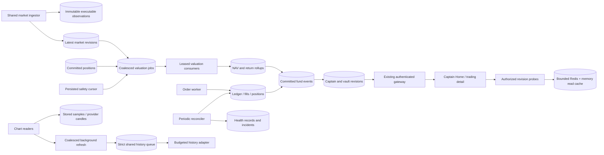

# Paper trading backend: revisions, durable work, and financial evidence

Implementation scope: seven improvements requested on 11 October 2026 IST. This document describes the implemented direction and acceptance checks; rollout/results are recorded separately. Existing dynamic-markets/discovery changes and unrelated working-tree edits must be preserved.

## Responsibilities and trust boundaries

PostgreSQL owns ledger entries, orders, fills, policies, observations, NAV, work generations, reconciliation incidents, and private revisions. Redis stores replaceable snapshots and distributed refresh locks. API caches never authorize a write or provide executable price evidence. A client can display an estimate; order submission and execution always recheck authoritative state. No fee, funding, delay, risk limit, seed amount or fill-model constant changes.



## 1. Affected-vault valuation

`market_latest` changes enqueue funds with positive exposure to that instrument through `positions_demand_idx`. Position quantity changes enqueue their fund. `fund_valuation_jobs` has one row per fund, a monotonically increasing generation, due time, attempt count and UUID lease token. Repeated updates coalesce; queue size scales with exposed funds rather than ticks.

Workers claim due rows in a short `SKIP LOCKED` statement, then release the job lock before locking the fund. This avoids a job-row/fund-row lock inversion with order transactions. Four consumers share the existing ten-connection pool. A 30-second lease recovers crashed workers. Acknowledgment deletes only the claimed token and generation. If a new price arrived meanwhile, the generation differs and its work remains due. Duplicate execution still serializes on the fund lock and existing market-reference deduplication prevents duplicate marks.

A persisted UUID cursor visits at most 100 exposed funds per cycle. A complete pass waits 30 seconds before starting another. It catches missed enqueue work and price aging; it is not a full scan every two seconds. Valuation unavailable transitions produce one unavailable NAV record rather than repeated synthetic values. Existing explicit full-sweep entry points remain available for compatibility/recovery. All holding marks must be valid; one missing holding prevents invented NAV. Drawdown checks remain in the fund transaction.

## 2. Authorized private context cache

Every read authenticates the account and runs an indexed ownership/revision probe before looking in cache. The key hashes account ID, route version, fund ID, selected instrument, dynamic capability and dependencies: committed sequence, cash/shares, lifecycle/deadline, policy version/risk limits, position quantities/bases, instrument eligibility and selected/held/policy market revisions. It cannot be reused by another account or route.

The response is built in a read-only repeatable-read transaction. Memory entries are bounded to 256 and concurrent keys to 512. Redis entries expire within one second and never later than source/receipt freshness or fund deadline. A six-second distributed lock coalesces replicas; waiters retry the shared result for at most 500 ms and then get an explicit retryable error. Redis failure falls back to at most eight local builders. Failed work is not cached. The builder runs once even if Redis publication fails. Client HTTP caching is disabled. No cached estimates enter preview, submit or fill calculations.

## 3. Captain Home private updates

A database trigger increments `captain_change_state` in the transaction that inserts a fund event. Rolled-back events cannot publish a revision. `captain.dashboard` extends `/v0/ws`; it never accepts another Captain's identity. Authentication, Captain role, expiry and role changes are checked. A shared gateway scan covers distinct subscribed Captains, rather than one query per connection.

Subscription sends `resync_required` with the current revision. The app then reads authorized snapshots, closing the read/subscription race. It ignores duplicate/older event revisions, coalesces refreshes and reconciles every 60 seconds on a healthy stream. Disconnects use jittered bounded polling; foreground/focus and reconnect force reconciliation. Existing vault-context and order recovery continue to work. Events contain invalidation metadata, never balances or raw financial payloads.

## 4. Accounting reconciliation

A persisted cursor checks up to 20 paper funds per cycle, including completed funds with outstanding claims, then waits five minutes after a full pass. Each check reads one repeatable-read database snapshot and serializes only competing auditors with a fund-scoped advisory lock. Financial writes remain independent.

Checks compare fund cash to its USDC ledger balance, each position quantity to its asset ledger balance, total economic supply to user plus protocol shares, per-event asset debits/credits, order/fill terminal consistency and fill evidence against the committed fill event. Snapshot consistency prevents a concurrent valid fill being mistaken for drift. Mismatches update durable state and open one incident per fund; repeated scans do not flood incidents. A later healthy scan resolves the incident while retaining its history. Logging and authorized health reads expose the result. There is no automatic balance repair or silent modification of orders, shares or ledger entries.

## 5. Stored charts and bounded backfill

Fresh stored charts return immediately from shared caches. A five-minute stored fallback returns with `cacheStatus: STALE` and original coverage/source timestamps while one owner refreshes in the background. A cache miss admits at most 16 local builds; overload remains explicit. Redis failure never triggers direct provider requests.

The history queue's old count-and-insert admission was vulnerable to concurrent replicas. `enqueue_market_history` serializes admission through a singleton row and performs its count under the function's subsequent statement snapshot. Normalized work keys still coalesce. Capacity is 200 active jobs; already-admitted keys remain readable when full. Negative coverage retries after five minutes. Waiting for quota does not consume a provider retry attempt. Workers preserve leases, fencing, provider provenance and gaps. Provider candles never enter executable observations. Live provider credentials remain an external gate.

## 6. Trade progress and operational visibility

Orders retain authoritative PENDING/FILLED/REJECTED/CANCELLED status. Additional progress describes WAITING_DELAY, WAITING_PRICE or WAITING_VALUATION; it cannot claim a fill. Reads return eligibility/expiry times, last attempt, attempt count, observation timestamp/age, retry delay and reason. Progress transitions produce committed invalidations only when the reason changes. Pending selection uses oldest attempt first so repeatedly unpriced orders cannot monopolize the first 20 slots.

Health reporting scopes pending ages, stages, execution latency, valuation queue and reconciliation status to the authenticated Captain. Global backfill queue aggregates are restricted to the admin route. Operational metrics must be bounded aggregates, with no per-user/mint cardinality explosion or secrets. Request acknowledgment and fill delay are separate measurements. Existing uncertain-response idempotency keys remain authoritative through app restarts.

## 7. Cash-flow-neutral returns

Keep AUM and its graph intact. Add a separate `CHAINED_ECONOMIC_UNIT_PRICE` series from committed round-v2 NAV economic share prices. Contributions/cancellations issue/redeem shares at the economic unit price, so they do not produce returns. Trading costs and final performance fees affect that price and remain included. Captain fee income is separate from investor net return.

Each fund stores its last processed snapshot/sequence and unit price. A per-Captain index starts at 100 and multiplies by each recorded unit-price ratio. The existing creation constraint permits one open round per Captain; the chain carries across sequential completed rounds. Overlapping manually-created rounds are marked as gaps rather than incorrectly treated as an equally weighted portfolio. Zero baselines do not yield percentages. Unavailable NAV records preserve a gap. Hourly/daily return rollups are read in at most 401 buckets; unknown prehistory is never padded. Migration replays recorded snapshots without modifying financial evidence. AUM, return percentage and fee income remain distinct API/UI concepts.

## Failure behavior and acceptance

- PostgreSQL unavailable: no financial writes, no fake progress/valuation, bounded API errors. Leases/cursors recover after reconnect.
- Redis unavailable: no unbudgeted provider calls; bounded DB fallback, original chart provenance, authoritative financial work intact.
- Worker crashes: leases expire; generations survive; existing fund locks and idempotency retain exactly-once effects.
- Provider stale/outage: keep source timestamps, mark unavailable, continue timeouts/reconciliation/committed notifications.
- App background/account switch: cancel private reads/subscriptions, retain uncertain order intent and resume with authenticated resync.
- Verify generation races, parallel claims, expired leases, cold/warm cache readers, ownership/eligibility changes, concurrent audit/fills, injected mismatches, strict 200-job admission, quota waits, trade progress fairness, deposits with flat return, fees/losses/sequential rounds, and stale/gapped history.

Apply additive migrations to disposable storage first. Build/typecheck both repositories; run financial regressions and targeted concurrency/load suites. Then migrate the intended local database, refresh existing watchers, check one ingestor leader and healthy API/Expo, and export the Android bundle. Remote deployment, historical-provider coverage and physical device behavior require separate evidence.

## Storage and bounded resources

| Store | Key / bound | Purpose | Durability / failure contract |
| --- | --- | --- | --- |
| PostgreSQL `fund_valuation_jobs` | One row per fund; four consumers; at most 100 claims per cycle | Coalesce affected exposure work | Token + generation fencing; 30s lease; exponential retry |
| PostgreSQL `paper_job_sweeps` | Two persisted keyset cursors | Aging/recovery and audit coverage | A crash retries coverage on a later pass; no in-memory cursor dependence |
| PostgreSQL `captain_change_state` | One row per Captain | Committed invalidation watermark | Same transaction as fund event; rollback cannot publish |
| PostgreSQL reconciliation state/incidents | One current result and at most one open incident per fund | Detect projection drift | Retain resolved incidents; no financial repair |
| PostgreSQL return state/rollups | One current index per Captain; hourly/daily buckets | Cash-flow-neutral return read model | Rebuildable from recorded NAV; gap evidence retained |
| Redis private snapshots | SHA-256 identity; <=1s TTL, <=6s refresh lock | Share repeat reads across API replicas | Never authorizes trades; bounded fallback if unavailable |
| Process private cache | 256 values; 512 pending keys; eight offline builders | Coalesce local readers | Replaceable; not financial storage |
| Redis/process chart snapshots | 5s fresh, 5min stale; 16 local builds | Serve stored charts during refresh | Original source/coverage retained; cold overload returns 503 |
| PostgreSQL history queue | <=200 active jobs across replicas | Provider work admission | Singleton admission lock; normalized keys; quota waits preserve attempts |
| Request metrics | <=40 route/status series per API process | Acknowledgment latency histogram | Process-scoped, resets on restart; no account/mint labels |

Valuation consumers stop claiming new work after a 1.5s admission budget. In-flight transactions can finish beyond that budget. Fund lock waits are capped at 500ms and individual valuation statements at 2s; a blocked fund yields instead of consuming the whole job batch. Audit failures are isolated per fund so another fund in the claimed batch can still be checked. The audit cursor commits its batch before checks: a crash can defer unfinished checks until the next complete pass. These are throughput bounds, not hard end-to-end worker deadlines.

Existing users are resolved by one indexed database lookup after JWT verification. Only first access enters the allowance/signup transaction. Concurrent first access still uses the existing unique identity and atomic ledger grant. Ownership and role remain live database checks; tokens, roles and permissions are not stored in the snapshot cache. The builder also reads accounting revision with the fund instead of issuing another round trip.

## Read and work sequences

```mermaid
sequenceDiagram
  participant App as Captain Home
  participant WS as Private gateway
  participant API as API
  participant DB as PostgreSQL
  participant Cache as Redis / memory
  App->>WS: authenticate(accessToken)
  WS->>DB: Verify identity, Captain role, current revision
  App->>WS: subscribe captain.dashboard
  WS-->>App: resync_required(revision)
  App->>API: Dashboard + performance + vault list
  API->>DB: Verify account / role; read committed snapshots
  API-->>App: AUM, Active/Crew counts, net trading return
  DB->>DB: Fund event + Captain revision commit atomically
  WS->>DB: Batched distinct Captain revision scan
  WS-->>App: captain.updated(revision, eventId)
  App->>App: Deduplicate and debounce 250ms
  App->>API: Reconcile authorized snapshots
  Note over App,WS: Focus loss/background closes stream; reconnect forces resync
  Note over App,API: Healthy stream also reconciles every 60s; disconnected fallback 15–20s
```

```mermaid
sequenceDiagram
  participant Price as Price ingestor
  participant DB as PostgreSQL
  participant Worker as Valuation worker
  Price->>DB: Commit latest mark and enqueue generation N
  Worker->>DB: Claim N with token T, release job row lock
  Worker->>DB: Lock fund; read all held executable observations
  Price->>DB: New mark commits; job becomes generation N+1
  Worker->>DB: Commit NAV + event + return index + Captain revision
  Worker->>DB: Delete WHERE token=T AND generation=N
  DB-->>Worker: No deletion: generation changed
  Worker->>DB: Clear only token T; N+1 remains due
  Note over DB,Worker: A crashed claimant loses its lease after 30s
```

```mermaid
sequenceDiagram
  participant Client as Trading detail
  participant API as API
  participant DB as PostgreSQL
  participant Worker as Order worker
  Client->>API: Submit intent + durable idempotency key
  API->>DB: Validate ownership, policy, limits; persist PENDING
  API-->>Client: Accepted order ID
  Client->>API: Read order progress
  API-->>Client: WAITING_DELAY + eligibleAt + expiresAt
  Worker->>DB: Claim order; lock fund; check post-lock database time
  alt No eligible post-delay price
    Worker->>DB: WAITING_PRICE, attempt time/count
  else Another holding cannot be valued
    Worker->>DB: WAITING_VALUATION
  else Executable evidence and limits valid
    Worker->>DB: Fill + balanced ledger + projections + NAV + event commit
  end
  Client->>API: Recover/read same order ID
  API-->>Client: Authoritative terminal status and actual fee/quantity
  Note over API,Worker: Neither cached context nor chart candles can execute an order
```

## HTTP and stream contracts

| Surface | Contract | Authorization / behavior |
| --- | --- | --- |
| `GET /v1/me/captain/dashboard` | Existing summary plus `dashboardRevision` | Current Captain; no-store |
| `GET /v1/me/captain/performance?range=7D\|30D\|90D\|ALL` | Existing AUM graph plus `tradingReturn` | Current Captain; AUM includes flows |
| `GET /v1/me/captain/returns?range=…` | Shared `TradingReturns` contract | Current Captain; <=401 points, explicit gaps/nulls |
| `GET /v1/me/captain/paper-health` | Owned order ages/stages, completion p95, valuation queue, reconciliation | Current Captain; no other Captain's state |
| `GET /admin/paper-trading/health` | Global queue/audit aggregates and process request metrics | Existing admin-token/loopback authorization; no-store |
| Existing v0/v1 order detail | Additional `execution` object | Existing route permissions retained; stage does not override status |
| `/v0/ws`, channel `captain.dashboard` | `resync_required`, `captain.updated`, stream/auth errors | Actor-scoped, expiry and role rechecked; no balance payloads |

Execution includes stage, eligibility/expiry, attempt time/count, observation source time/age, reason and retry delay. Both execution and return contracts live in `packages/contracts/src/paper-trading.ts`; `scripts/sync-paper-contracts.mjs` generates the APK copy, and `--check` rejects drift. The app remains compatible with responses that omit the additive fields.

The Home card keeps its existing AUM graph, period tabs and Active/Crew metrics. A separate net trading return line follows the selected period and respects balance hiding. This prevents a deposit from appearing to be trading profit. Missing return evidence displays “Unavailable”. Pending order messages explain delay, missing trade price or missing holding valuation. No extra trade confirmations are introduced.

## Capacity model and architectural choices

PostgreSQL jobs were chosen over Redis-only queues so a committed position/price change and its work cannot be split by a Redis outage. The queue stores current work generations rather than one job per tick. PostgreSQL remains the financial source of truth; Redis is useful for shared short-lived reads and refresh coordination, and can be rebuilt. No additional service or paid dependency is required.

Let `F` be exposed funds, `E(m)` funds holding updated mint `m`, and `C` connected Captains. Price-driven enqueue cost follows `E(m)`; the safety cursor visits `F` once per completed pass instead of each two-second cycle. Private socket scans batch distinct accounts rather than querying per connection. A quiet Home performs three core reads every 60s, approximately `3C` reads/minute instead of `12C` under its former 15s polling. Open crew/earnings panels add a fourth read, and committed activity adds debounced reads. This is a request-count model, not a measured sustained device workload.

The API read probe still touches PostgreSQL on every private request. This is deliberate: eligibility, lifecycle and ownership changes must not wait for a TTL. Very diverse cold reads do more work than repeated reads; explicit limits and retryable overload remain necessary. The load evidence measures this distinction. Provider call budgets are shared by organisation; user count never creates an independent provider budget. At five-second price cadence, 50-mint provider batches need roughly `12 * ceil((demandedMints + quoteMint)/50)` calls/minute before existing quota controls.

## Rollout and recovery runbook

1. Build backend packages and run disposable SQL/Redis regressions before applying migrations 031 and 032. The return migration replays historical v2 snapshots; allow time proportional to recorded history and inspect its duration before a production rollout.
2. Keep environment-specific databases and Redis namespaces/instances isolated. Deploy migrations before the new API/worker code; old application code can ignore these additive tables/fields. The local development watchers were verified after migration.
3. Verify `/health`, protected admin paper health, migration names, one ingestor advisory leader, job backlog/lease ages, and reconciliation coverage. An empty queue on an idle system is healthy; it is not load-capacity evidence.
4. If valuation work accumulates, inspect oldest due work and database lock pressure. Leases recover automatically. Avoid deleting durable work or rewriting NAV. The explicit full sweep exists for controlled recovery but is more expensive.
5. If reconciliation reports MISMATCH, preserve evidence and compare the named checks with immutable events/ledger entries. Resolve the underlying bug under a separate reviewed repair; never treat cache flushes as accounting repair. A later healthy audit closes the incident.
6. Redis can be restarted without altering money. Private reads fall back within bounds; charts retain cached/stored provenance. Expect retryable cold overload during recovery rather than increasing provider traffic.
7. Roll back application code if required while retaining additive migrations and evidence. Re-enabling old full-sweep workers increases database load; verify work cadence after rollback. Do not drop incident/return/job tables during incident response.
8. Historical provider coverage requires its existing enable flag and credential. Keep it off when unconfigured. Android export verifies bundling; test foreground/background, account switching and network loss on a physical build before release.

Evidence and measured results: [implementation report](paper-trading-system-implementation.md), [load JSON](paper-trading-load-evidence.json), [local runtime JSON](paper-trading-runtime-evidence.json).
