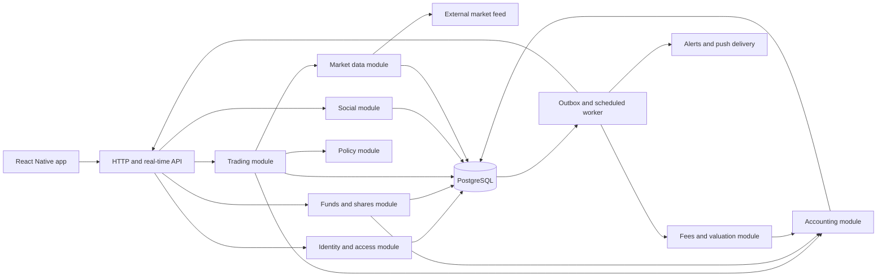

# socially.trade v0: Paper Trading Architecture

**Status:** implementation proposal
**Scope:** paper trading only
**Product basis:** `socially-trade-whitepaper.pdf` (September 2026)

## 1. Goal and product contract

v0 lets a Captain run a public, simulated fund and lets Crew members join it with virtual USDC. The Captain places simulated spot trades. Everyone sees the same holdings, trade history, share price, performance, and decision log. A completed trial becomes a permanent part of the Captain's **paper** record.

The first release should prove three things:

1. Captains will trade consistently and explain their decisions.
2. Crew members will follow a fund and understand its results and risk.
3. The app can produce a credible, reproducible simulated performance record.

Every balance, share, trade, fee, and return in v0 is simulated and stored offchain. v0 does not create a Solana wallet, send a transaction, hold USDC, or give a user a claim on assets. Market data may describe Solana markets, but reading that data does not make a paper trade onchain.

The app must show **Simulated** beside balances, returns, trade alerts, fund cards, and Captain rankings. A future live fund will have a separate identity and record.

## 2. Decisions for v0

| Area | Decision |
| --- | --- |
| Client | React Native mobile app, using Expo development builds when native integrations require them |
| Backend | TypeScript modular monolith: one HTTP application plus one worker process from the same codebase |
| Primary store | PostgreSQL for users, funds, orders, immutable ledger entries, price observations, and projections |
| Real-time delivery | Server-sent events or WebSocket for fund activity; ordinary HTTP remains the source for page refresh and recovery |
| Async work | PostgreSQL outbox and a worker; add a dedicated message broker only when measured load requires it |
| Cache | Optional. Start without Redis; add it for hot price/fund reads only when needed |
| Money math | Decimal/integer arithmetic with explicit units and rounding; never JavaScript floating point for accounting |
| Market | Allowlisted, liquid spot assets priced in virtual USDC; no leverage, shorting, derivatives, or newly launched tokens |
| Trial | One public 30-day sea trial per Captain at a time; trial results remain visible after completion |
| Crew budget | Each account gets a fixed, nontransferable virtual USDC allowance; no user-controlled top-ups during a trial |
| Captain stake | Captain contributes a fixed virtual seed amount when the fund starts; show it separately from Crew contributions |
| Performance fee | Simulate the whitepaper's 10% high-water-mark fee at most once per day; 80% of minted fee shares to Captain, 20% to protocol account |

These are product defaults for implementation, not claims that the whitepaper already specifies all paper-trading parameters. Keep the amounts and limits in versioned configuration so a trial's rules cannot silently change.

### Initial asset and rule set

Start with virtual USDC as base currency and a small allowlist of liquid spot assets. Each asset needs a stable internal instrument ID, token mint/address where relevant, display symbol, decimal precision, price source, and status. Symbols alone are not identifiers.

Suggested initial policy: no borrowing; no short positions; a maximum of 25% of NAV in one non-USDC asset; a maximum order size of 10% of NAV; and a 30% drawdown breaker that permits selling to virtual USDC but stops new buys. Exact numbers are configurable before trial creation and then frozen for that trial. Use the whitepaper's more complex token tiers and thin-market rules only when the simulation has reliable liquidity data.

## 3. User flows that the architecture must support

### Captain

1. Sign up and create a Captain profile.
2. Create a simulated fund, choose a strategy label, review rules, and start a 30-day trial.
3. See virtual cash, positions, NAV, available buying power, and risk limits.
4. Preview an order, then submit it. The preview is an estimate; the final fill is recorded by the server.
5. See a pending, filled, partially filled, or rejected result. Post a reason linked to the order.
6. See Crew activity, alerts, drawdown, fees, and the trial clock.
7. Finish the trial with a permanent performance page; apply separately for a future live fund.

### Crew

1. Sign up and receive a fixed virtual USDC practice balance.
2. Discover funds using return, drawdown, trial age, strategy, and complete trade history.
3. Join at the current share price with a chosen virtual amount.
4. Watch fund holdings, trade events, Captain explanations, own shares, own value, and chat.
5. Leave at a current valid valuation; receive virtual USDC minus disclosed simulated exit costs, if any.

There is no cash-out, card payment, on-ramp, or wallet connection in the paper experience.

## 4. System view



This is one deployed backend codebase. The boxes describe **modules**, not separate network services. Modules expose small interfaces and own their rules; the HTTP layer coordinates requests without reimplementing accounting or risk logic.

### Module interfaces

| Module | Small interface | Rules it owns |
| --- | --- | --- |
| Identity and access | `actorFor(session)`, `can(actor, action, resource)` | Account identity, Captain role, fund ownership, Crew access |
| Market data | `getFreshPrice(instrument, at)`, `recordObservation(raw)` | Source selection, freshness, instrument mapping, quote provenance |
| Policy | `evaluate(order, fundState, price)` | Allowlists, position caps, size limits, drawdown breaker |
| Trading | `submitOrder(command)`, `processOrder(orderId)` | Order lifecycle, idempotency, fill model, rejection reasons |
| Accounting | `post(entries, eventId)`, `balance(account)` | Balanced ledger entries, share/cash/asset movements, rounding |
| Funds and shares | `joinFund(command)`, `leaveFund(command)` | NAV-based share mint/burn, membership, virtual budgets |
| Valuation and fees | `valueFund(fundId, at)`, `assessFee(fundId, day)` | NAV, share price, high-water mark, fee shares, stale-price behavior |
| Social | `postMessage(command)`, `linkTradeNote(orderId, note)` | Fund chat, moderation state, Captain decision log |
| Notifications | `deliver(eventId)` | Trade, fee, policy, and trial alerts; delivery retry |

The future live implementation can reuse **read concepts** such as fund cards and trade history. Its execution adapter must derive authority from confirmed Solana transactions and program state. A paper database result is never accepted as evidence of a live trade.

## 5. Authoritative data and accounting

PostgreSQL is authoritative for v0. The mobile app may cache screens, but it never calculates or writes official positions, shares, NAV, or returns.

Use an append-only event and ledger model:

- `fund_events`: immutable domain events such as `fund_started`, `order_submitted`, `order_filled`, `crew_joined`, `fee_assessed`, and `trial_completed`.
- `ledger_entries`: balanced movements between virtual accounts. Every posted financial event has entries that sum to zero per asset and reference one event ID.
- `orders` and `fills`: immutable terms and execution evidence, including source price, observed time, fill time, slippage model version, fee, and rejection reason.
- `positions`, `share_balances`, `fund_nav_snapshots`, and leaderboard rows: rebuildable projections for fast reads.

Model the virtual market as explicit counterparty accounts: a buy moves virtual USDC from the fund to the market account and the bought asset from the market account to the fund. Share issuance and burning likewise use explicit issuance accounts. This keeps entries balanced per asset without implying that tokens actually moved on Solana.

Never edit a historical fill to fix a mistake. Post a correction event with a reason and a link to the original event. Keep `created_at`, `effective_at`, and source observation times distinct.

### Suggested tables

| Table | Key fields |
| --- | --- |
| `users` | `id`, auth subject, status, created time |
| `captain_profiles` | `user_id`, public handle, bio, status |
| `instruments` | ID, mint/address, symbol, decimals, active status, price source |
| `funds` | ID, Captain ID, mode=`PAPER`, status, base asset, created time |
| `fund_policy_versions` | Fund ID, version, limits JSON or typed columns, effective time, immutable hash |
| `trials` | Fund ID, start/end time, status, rule version, initial seed amount |
| `memberships` | Fund ID, user ID, joined/left times |
| `orders` | ID, fund ID, Captain ID, client idempotency key, side, asset, quantity/notional, status, submitted time |
| `fills` | Order ID, filled quantity, observed market price, simulated fill price, model version, price observation ID, fees, time |
| `price_observations` | Instrument ID, source, source timestamp, received timestamp, price, depth/quote reference, quality status |
| `fund_events` | Event ID, fund ID, event type, sequence number, payload, recorded time |
| `ledger_entries` | Event ID, virtual account ID, asset ID, signed amount, sequence number |
| `share_balances` | Fund ID, holder ID, current shares; projection from ledger |
| `positions` | Fund ID, instrument ID, quantity, cost basis; projection from ledger |
| `nav_snapshots` | Fund ID, NAV, share supply, share price, valuation time, price IDs, status |
| `fee_assessments` | Fund ID, day, HWM before/after, fee value, shares minted, event ID |
| `messages` | Fund ID, author ID, body, linked order ID, moderation status |
| `outbox_events` | Event ID, type, payload, status, attempts, next attempt time |

Use `NUMERIC` or integer minor units for amounts and explicitly encode asset decimal precision. Apply unique constraints to `(fund_id, event_sequence)`, `(fund_id, fee_day)`, and order idempotency keys. Financial writes run in a database transaction and lock the fund row so concurrent orders, joins, exits, and fee assessments serialize for that fund.

### Share accounting

At fund creation, choose a fixed initial share price of 1 virtual USDC and mint shares against the Captain's virtual seed. Then:

```text
NAV = virtual USDC cash + sum(position quantity × valid mark price)
share_price = NAV / total_shares
shares_minted_on_join = deposit / share_price_before_join
virtual_value_on_leave = shares_burned × share_price_before_leave
```

Deposits and exits must use a fresh, recorded valuation. They change total NAV and share supply together, so they should not change share price apart from disclosed costs and rounding. Return rankings use share-price change over a fixed period, not changes in total fund size. Crew-specific gains use their own contribution and withdrawal history.

When a required price is stale or missing, mark the valuation `UNAVAILABLE` and stop orders, joins, exits, and fee assessment that depend on it. Keep the last valid value visible with its timestamp and a stale label. Do not silently carry it forward as a current price.

### Simulated performance fee

For the initial liquid-asset allowlist, value positions at their valid mark prices. Once per UTC day, if the pre-fee share price exceeds the post-fee high-water mark, calculate 10% of the gain above that mark and mint fee shares to virtual Captain and protocol accounts in the 80/20 split. Record the formula inputs, output, and fee model version in one event. Set the new HWM to the post-fee share price. Assess no fee when the fund remains below its HWM. If the pricing inputs are stale, skip and retry when valuation is valid; never invent a price.

The fee is a **simulation**. No virtual or real cash is paid out. If this module delays the first usable build, keep its schema and event type but launch privately with fees disabled and a clear `fees not included` label until it is implemented. Do not publish net-return rankings while fees are disabled.

## 6. Price and execution model

Paper performance is only useful if fills are reproducible and reasonably conservative.

1. Ingest current market observations from a provider for every allowed instrument. Store the raw source reference, source time, receipt time, and normalized price. Never accept a client-supplied price.
2. At order submission, persist the order and return `PENDING`. The preview shows an estimate only.
3. After a short configured delay, the worker reads the next fresh observation. It then opens a database transaction, locks the fund, and runs the policy checks again against current fund state. Do not hold a database transaction open during a network request to the price provider.
4. Compute the simulated fill from that observation using a published spread, fee, and size-based slippage schedule. Cap order size relative to observed liquidity. If required data is missing, reject rather than fill at an old quote.
5. Persist the fill, ledger movements, fund event, and notification outbox row in one transaction.

The delay prevents a Captain from seeing a price and receiving a guaranteed fill at that already-known price. Store a `fill_model_version` on every fill so the record remains interpretable if assumptions change. Do not backdate orders or let administrators choose fill prices. Record rejected and cancelled orders as part of the public trial history.

The v0 model is an estimate of spot execution, not a promise that a real Jupiter route would have filled at the same price. Before supporting thin tokens, require usable depth/route data and a liquidation model; otherwise the simulation would reward trades that could not be executed at the displayed size.

## 7. Write paths and failure handling

### Submit a Captain order

```mermaid
sequenceDiagram
    participant C as Captain app
    participant A as API
    participant D as PostgreSQL
    participant W as Worker
    participant M as Market data
    participant U as Crew app
    C->>A: Submit order + idempotency key
    A->>D: Validate actor; insert PENDING order
    A-->>C: Order ID and PENDING
    W->>M: Read stored fresh price observation
    W->>D: Lock fund and pending order
    W->>W: Check policy and calculate fill
    W->>D: Commit fill + ledger + event + outbox
    D-->>W: Committed
    W-->>U: Trade event or rejection alert
```

If the worker crashes before commit, retry the order. If it crashes after commit, the unique order/fill key prevents a second fill; the outbox delivers the existing event later. Clients retry POST requests with the same idempotency key and receive the same order ID.

### Join or leave

Lock the fund, obtain a fresh valuation, validate the user's virtual budget or shares, post balanced ledger entries, update share projections, append an event, and commit. A retry with the same idempotency key returns the original result. For v0's liquid allowlist, a paper exit settles immediately at the recorded valuation after any modeled exit cost. The whitepaper's real-fund token liquidation queue is a separate live-product feature.

### Real-time screens

Clients load authoritative state through HTTP, then subscribe to fund events after the last seen event sequence. On reconnection, request missed events by sequence and refresh the fund snapshot. Notifications are a convenience; missing one must never change balances or hide a trade.

## 8. External interfaces

Version the HTTP surface from the start. Illustrative endpoints:

```text
POST   /v0/auth/session
GET    /v0/funds?sort=drawdown|return|age
POST   /v0/funds
GET    /v0/funds/{fundId}
GET    /v0/funds/{fundId}/history
GET    /v0/funds/{fundId}/events?after={sequence}
POST   /v0/funds/{fundId}/orders
GET    /v0/funds/{fundId}/orders/{orderId}
POST   /v0/funds/{fundId}/joins
POST   /v0/funds/{fundId}/exits
GET    /v0/me/paper-balance
GET    /v0/me/paper-positions
GET    /v0/captains/{captainId}/paper-record
GET    /v0/funds/{fundId}/messages
POST   /v0/funds/{fundId}/messages
```

Every mutating request carries an idempotency key. Responses include `mode: PAPER`, server timestamps, valuation status, and relevant event sequence. Use cursor pagination for event, order, and chat history. The server derives Captain authority from the authenticated user and fund ownership; it never trusts a role or fund owner sent by the client.

## 9. Security, integrity, and operations

- Authenticate users with a managed identity provider or equivalent session system. Use server-side authorization on every fund action. One account can act as Captain and Crew, but cannot create unlimited concurrent trial funds.
- Rate-limit account creation, orders, chat, and joins. Reserve stronger person verification for Captain qualification; do not call a v0 account "one verified human" without performing that check.
- Store secrets only on the backend. Protect market-data credentials, signing keys for sessions, and notification credentials. The app contains no real trading authority in v0.
- Audit administrative actions. Corrections create events; administrators cannot silently edit fills or performance.
- Back up PostgreSQL, verify restore procedures, and retain immutable ledger/event history for the life of a trial record.
- Monitor market-data lag, stale valuations, pending-order age, rejected orders, outbox backlog, ledger imbalance, and projection drift. Page the team when pricing stops or accounting invariants fail.
- Rebuild projections from ledger and events in a maintenance command. Run a periodic reconciliation between entries, positions, share supply, NAV snapshots, and public profile figures.
- Maintain separate development, staging, and production databases. Never seed production trials with fabricated trades.

### Core invariants

1. Each financial event's ledger entries balance per asset.
2. A fill exists once per order and references the price observation and model version used.
3. A fund cannot have negative virtual cash, negative spot positions, or negative share supply.
4. Only the Captain can submit orders for their fund; Crew can join, leave, and chat.
5. Deposits and exits cannot change share price except for disclosed costs and rounding.
6. An order, join, exit, or fee event cannot settle against stale or missing prices.
7. A trial's starting balance, policy version, and period cannot change after it begins.
8. Paper and future live balances, events, and rankings never share an accounting namespace.

## 10. Delivery sequence

| Stage | Deliverable | Exit criterion |
| --- | --- | --- |
| 1. Foundation | Auth, Captain profile, instruments, fund/trial creation, virtual budget | One Captain can start one immutable trial |
| 2. Accounting | Ledger, shares, joins/exits, valuation snapshots | Crew value and share supply reconcile after deposits and exits |
| 3. Trading | Price ingestion, order lifecycle, policy checks, fills | Every trade has a reproducible price and balanced ledger entries |
| 4. Social | Fund feed, decision notes, chat, real-time delivery, alerts | Crew sees Captain actions and explanations in order |
| 5. Record | Performance charts, drawdown, simulated fees, public history | A completed trial can be recomputed from recorded events |
| 6. Beta hardening | Admin audit, reconciliation, monitoring, recovery, abuse limits | Pricing or worker failures pause affected actions without corrupting balances |

Deploy to a private beta after stage 4, with explicit simulated labels and no public performance rankings until stage 5 is complete.

### Suggested repository layout and deployment

```text
apps/mobile/             React Native screens and client data access
apps/api/                HTTP and real-time transport, authentication adapter
apps/worker/             Order processing, valuation schedule, outbox delivery
packages/domain/         Fund, order, policy, share, and fee rules
packages/contracts/      Request/response schemas and public event types
packages/db/             Migrations, repositories, projection rebuilds
packages/market-data/    Provider adapter and normalization
```

The API and worker can run from the same backend package and image with different start commands. Deploy one managed PostgreSQL database, one API process, one worker process, and the market-data connection. Scale the API independently of the worker if usage grows. Run schema migrations as a controlled deployment step; pin the fill and fee model versions used by active trials so a deployment cannot rewrite their historical meaning.

## 11. Path to the whitepaper's live product

Keep `PAPER` and `LIVE` as distinct fund modes and IDs. Reuse the user-facing language and read model where it remains accurate, but build a separate live write path:

```text
Paper order -> simulation engine -> PostgreSQL ledger -> paper projections
Live order  -> signed Solana transaction -> program/venue -> chain indexer -> live projections
```

The live protocol must enforce custody, delegate permissions, policy checks, shares, fees, and exits onchain as described in the whitepaper. A shared TypeScript policy calculation can help previews and comparisons, but it is not a substitute for onchain enforcement. Publish Captain paper history and live history in separate sections, with distinct return series and labels. Do not merge paper gains into live performance or migrate virtual shares into real shares.

## 12. Open decisions before implementation

1. Exact virtual allowance and Captain seed amount per account/trial.
2. Which assets have dependable price and liquidity observations for the first beta.
3. Market-data provider and the documented spread/slippage schedule.
4. Whether a Crew account can join multiple funds at once and how its fixed allowance is allocated.
5. Trial completion and Captain qualification rules beyond the initial 30-day duration.
6. Chat moderation and whether Captain trade explanations are editable (recommend append a correction; preserve the original).

These choices affect configuration and UI copy. They do not require changing the core accounting or execution architecture.

## References

- [socially.trade whitepaper](../socially-trade-whitepaper.pdf), especially chapters 3-9 and 13.
- [Expo development builds](https://docs.expo.dev/develop/development-builds/introduction/) for the proposed mobile workflow.
- [Solana programs](https://solana.com/docs/core/programs) for the later live execution model.
